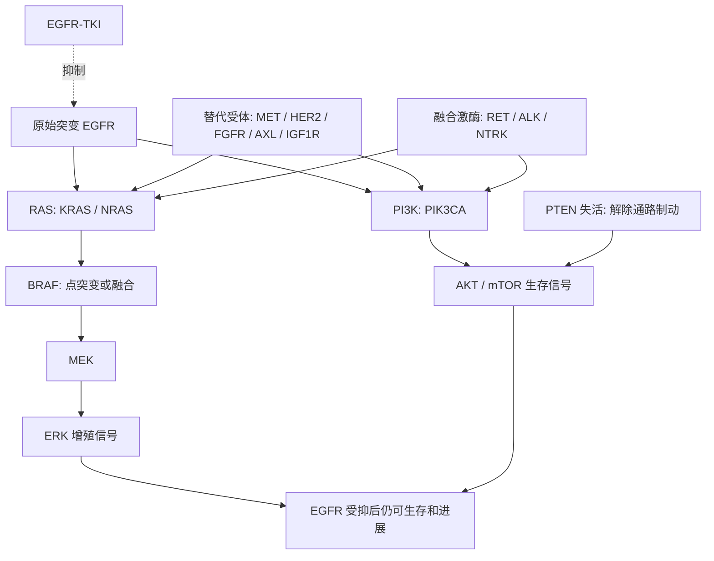
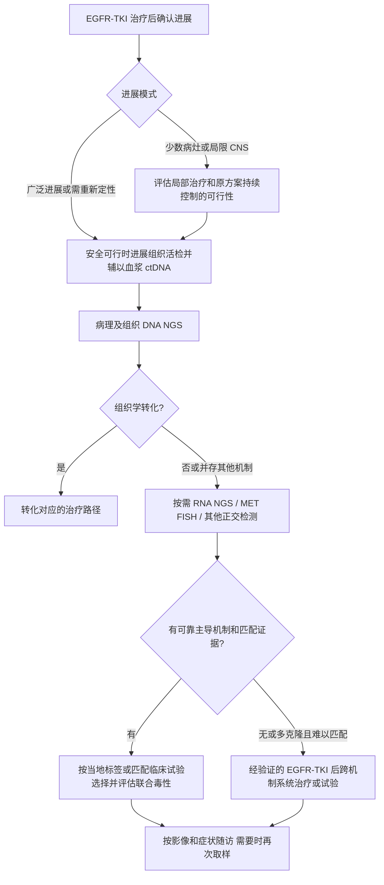

# EGFR 突变肺癌：15 类重点旁路及下游再激活耐药机制

**机制、检测、克服策略与未来前景｜整理于 2026-10-29｜叙述性综述工作稿**

> 本稿回答 EGFR-TKI，尤其奥希替尼治疗后的耐药问题。**现有证据不能支持统一的“最常见前 15 名”排行榜**；下列是 15 类重点机制，编号不是发生率名次。医学文献与监管网站在本次环境中被代理拒绝访问，以下基于可识别既往研究整理，尚未在线逐项复核，不能声称已检索覆盖至整理日。最新适应证须另核对。[方法与核验记录](methodology.md)｜[参考资料](references.md)｜[CSV 证据表](evidence-matrix.csv)

## 1. 先明确“旁路耐药”与“最常见”

EGFR-TKI 阻断原始 EGFR 驱动后，肿瘤可借助其他受体或激酶重新打开 RAS–MAPK、PI3K–AKT 等生存通路。这是旁路耐药。也可能直接改变下游分子，从而不再需要 EGFR 传入信号；本文将这类**下游再激活**单独标出，纳入广义 EGFR 非依赖性耐药。[R01](references.md#r01)

**MET 扩增是奥希替尼后最一致地反复检出的主要可干预旁路。** HER2 扩增、PIK3CA、KRAS、BRAF 等在多个临床队列出现；RET/ALK/NTRK 等获得性融合少见。AXL 等涉及蛋白表达、细胞状态和非基因组调控，无法与血浆 NGS 检出的突变作同一尺度的发生率排名。[R02](references.md#r02) [R03](references.md#r03) [R04](references.md#r04)

不能把不同研究比例拼成“前 15 名”，原因包括：

- **人群不同**：一线奥希替尼与 T790M 阳性后线奥希替尼不同；早代 EGFR-TKI、联合化疗或联合抗体后的耐药谱也不同。
- **分母不同**：所有接受治疗者、所有进展者、有配对血浆者、成功再活检者并不是同一群人。会议早期分析与最终论文也可能使用不同可评估集。
- **检测不同**：血浆低肿瘤含量会漏掉扩增和融合；普通 DNA panel 不能充分识别蛋白激活、细胞状态或组织学转化。
- **机制可重叠**：同一患者可同时出现 MET、RAS 或组织转化等多个事件；百分比不能直接相加，检出也不必然意味着因果。

因此，本稿不填入尚未核对原文分母的精确发生率。它提供**频率可解释性、机制依据及治疗成熟度**，而不是用推测数字补齐排名。

### 不计入这 15 项，但必须排查

| 类别 | 代表事件 | 为什么另列 |
|---|---|---|
| EGFR 靶内改变 | C797S、早代 TKI 后的 T790M、其他药物结合相关变异 | 是靶内耐药；后续药物选择取决于具体等位基因及既往治疗 |
| 谱系/组织学转化 | 小细胞转化、鳞状转化 | 需组织病理确认，治疗逻辑可能完全改变，不能归为受体旁路 |
| 药物暴露或解剖学问题 | 中枢“庇护”部位、相互作用、依从性问题 | 不是检出一条旁路即可解释的分子耐药 |
| 其他研究路径 | YAP/TEAD、细胞周期、MAP2K1 等 | 非穷尽清单；本轮未补齐逐项原始资料，不用于建立发生率排名 |

转化与多克隆异质性的重要性见 [R04](references.md#r04)、[R05](references.md#r05)、[R18](references.md#r18)。

## 2. 15 类机制总览

机制证据：M1＝临床队列反复观察；M2＝少量临床样本加功能支持；M3＝模型/有限转化证据为主。治疗证据：T1＝该耐药情境有前瞻性介入试验；T2＝病例/小系列；T3＝本文所列克服路径以临床前或推演为主。**不是指南分级，也不代表获批状态**；完整定义见[方法](methodology.md)。未定位原始人体报告的策略保守列 T3，不表示已证明没有任何人体报告。

| 编号 | 机制与分类 | 临床频率如何理解 | 可能的克服路径 | 机制/治疗证据 |
|---|---|---|---|---|
| 01 | MET 扩增；受体旁路 | 最一致的主要旁路，具体比例取决于队列及阈值 | EGFR＋MET 双抑制；按当地标签/试验选择 | M1 / T1 |
| 02 | ERBB2/HER2 扩增；受体旁路 | 反复报道的低频事件，与突变分开 | HER2 定向方案或 EGFR＋HER2 的研究 | M1 / T3；相关人体研究标志物需另审 |
| 03 | KRAS 激活突变/扩增；下游 | 低频，突变和扩增不能合报发生率 | 等位基因匹配的 RAS 靶向联合研究 | M1 / T3；病例线索待核验 |
| 04 | PIK3CA 激活突变；下游 | 低频，可为预存共变异 | EGFR＋PI3K/AKT/mTOR 研究 | M1 / T3 |
| 05 | BRAF 激活点突变；下游 | 低频，V600 与非 V600 不同 | V600E 的 EGFR＋BRAF＋MEK 个案策略；其他按功能分类 | M1 / T2（V600E 病例待复核）–T3 |
| 06 | RET 融合；激酶旁路 | 罕见，有小型人体治疗队列 | EGFR＋选择性 RET 抑制 | M2 / T2 |
| 07 | HER2 激活突变；受体旁路 | 罕见，需证明继发性/克隆作用 | HER2 突变定向试验，研究是否需 EGFR 联合 | M2（原始病例待复核） / T3 |
| 08 | NRAS 激活；下游 | 少见；模型证据占重要部分 | MEK/ERK 等联合研究 | M2–M3 / T3 |
| 09 | BRAF 融合；下游 | 罕见，不能并入 V600E | EGFR＋MEK 或 RAF 二聚体抑制研究 | M2 / T3 |
| 10 | ALK 融合；激酶旁路 | 罕见，以病例/小系列为主 | EGFR＋ALK 抑制研究 | M2 / T2 |
| 11 | NTRK 融合；激酶旁路 | 极罕见，无稳健总体估计 | 功能融合确认后的 EGFR＋TRK 研究 | M2（原始病例待复核） / T3 |
| 12 | FGFR 通路；受体旁路 | 融合、扩增、自分泌不可混算 | 按具体事件匹配 EGFR＋FGFR 研究 | M2–M3 / T3 |
| 13 | AXL 上调/激活；非基因组旁路 | 无统一临床发生率 | AXL 抑制＋EGFR 的早期探索 | M2–M3 / T3 |
| 14 | IGF1R 激活；受体旁路 | 无统一临床发生率，模型为主 | EGFR＋IGF1R/IR 的机制研究 | M3 / T3 |
| 15 | PTEN 缺失/失活；下游 | 定义与检测不统一，可靠比例不足 | PI3K/AKT/mTOR 轴研究，不能自动匹配 PI3Kα 药 | M2–M3 / T3 |

这些标签是类别层面的保守概括，不能替代每种变异、每个病例和每项研究的评价。表中“克服”表示有证据支持或值得检验的路径，**不表示每一种机制都有已证实有效的药物**。

## 3. 信号网络图

图为简化的信号关系，不表示所有改变同等常见，也不代表同一肿瘤必然存在全部连接。下游节点激活与替代受体旁路是不同层次。

## 4. 逐项阐述与干预前景

### 01. MET 扩增

**如何耐药。** MET 拷贝数增加，可经 ERBB3 等重新激活 PI3K–AKT 和 MAPK。肿瘤内仍可能保留 EGFR 依赖克隆，因此只换成 MET 单药不一定控制全部病灶。[R06](references.md#r06)

**如何确认。** 进展组织 NGS 可配合 MET FISH；报告平均基因拷贝数、MET/CEP7 比值、肿瘤含量并区分局灶扩增与染色体多倍体。IHC 高表达不是扩增的同义词。INSIGHT 2 与 SAVANNAH 的 FISH/IHC 富集标准不同，不能互换或用来直接比较疗效。血浆阴性尤其不能排除扩增。

**怎样克服。** 奥希替尼联合赛沃替尼、特泊替尼等有前瞻性人体研究；主要证据包括 TATTON、INSIGHT 2、SAVANNAH 和 SACHI。药物、剂量、人群和地区适应证需逐项区分，不能将 MET exon14 跳跃的单药批准等同于 MET 扩增联合治疗批准。中国已有 2025 年赛沃替尼＋奥希替尼获批的历史报道；本次未复核 NMPA 现行标签，故不能写成“所有 MET 联合均未获批”，也不提供未经核验的中国适应证原文。[R08](references.md#r08)–[R11](references.md#r11)

**下一步。** 统一高水平 MET 依赖的筛选标准，验证随机比较、CNS 控制和总生存获益；对 MET 二次突变、多克隆耐药探索不同结合类型抑制剂、双抗或 ADC。水肿、肝毒性和肺炎等会限制组合；特定 MET 突变对不同药物的敏感性不可一概而论。

### 02. ERBB2/HER2 扩增

**如何耐药。** HER2 拷贝数增多可增强 HER2–HER3 及下游生存信号。**扩增、蛋白过表达和激活突变是三个不同标志物**，不能用 HER2 改变总数代替扩增率。[R07](references.md#r07)

**如何确认。** 组织 NGS、必要时 FISH，并独立记录 IHC；比较治疗前后样本，判断是否为新出现或原有亚克隆被选择。血浆不能可靠排除局灶高扩增。

**怎样克服。** HER2 抑制剂、抗体或 ADC，以及与 EGFR 抑制联合有机制依据，但在这一继发扩增人群的证据有限，优先匹配试验。T-DXd 在 HER2 突变肺癌或特定 IHC3+ 实体瘤的历史批准，均不意味着任意 HER2 扩增都满足标签；药物是否适用必须核对具体生物标志物。[R25](references.md#r25)

相关联合研究也需审查，包括 TRAEMOS 的奥希替尼＋T-DM1 探索；不能只展示机制模型而忽略临床效果有限的可能性。其表达筛选条件不能直接等同于“确认 HER2 扩增旁路”，本轮未核验结果，不报有效率。[R31](references.md#r31)

**下一步。** 联合拷贝数、IHC、RNA 和克隆结构筛选真正 HER2 依赖者，探索 ADC 与 EGFR 的序贯或联合；需控制间质性肺病等风险，而非仅依据体外协同选择用药。

### 03. KRAS 激活突变或扩增

**如何耐药。** KRAS 持续推动 RAF–MEK–ERK，使上游 EGFR 关闭后仍能增殖。突变、扩增以及 G12C/G12D/G12V 等不同等位基因不是同一药物靶点。[R01](references.md#r01) [R12](references.md#r12)

**如何确认。** 组织/血浆 DNA NGS 明确位点和拷贝数，结合治疗前样本、原 EGFR 驱动及病灶背景，排除预存共变异、另一原发肿瘤或非主导克隆。

**怎样克服。** 对继发 KRAS G12C，EGFR 加 G12C 抑制剂可作为试验/个案研究方向；G12D、G12V 不能套用 G12C 药物。RAS(ON)、pan-RAS、SHP2/SOS1、MEK/ERK 组合各有不同适用生物学，不能视为通用方案。KRAS G12C 独立驱动肺癌的药物批准不证明该继发旁路联合有效或获批。

**下一步。** 进行等位基因和克隆分层、串行 ctDNA 监测及联合治疗窗研究。SHP2/SOS1 依赖因突变而异；胃肠道、肝脏、皮肤和肺部毒性可能抵消多靶点协同。

### 04. PIK3CA 激活突变

**如何耐药。** PIK3CA 的部分热点变异可维持 PI3K–AKT–mTOR 生存信号。这是**下游再激活**；PIK3CA 也可能在治疗前已存在，检出并不自动证明它是当前进展的主因。[R01](references.md#r01) [R18](references.md#r18)

**如何确认。** 组织/血浆 DNA NGS，记录位点、克隆丰度、肿瘤纯度及其他共存机制。研究性 pAKT 结果可以辅助，但不是通用的伴随诊断。

**怎样克服。** EGFR 联合 PI3K、AKT 或 mTOR 抑制是研究方向，尚不能从其他肿瘤的 PI3K 药物批准推导该组合为标准。没有成熟匹配证据时，不应因这一结果放弃经验证的 EGFR-TKI 后系统治疗。

**下一步。** 识别真正 PI3K 依赖者并降低高血糖、皮疹、腹泻等重叠毒性；重点是证明获益预测能力，而非扩大任何 PIK3CA 阳性病例的用药范围。

### 05. BRAF 激活点突变

**如何耐药。** V600E 通常是 RAS 非依赖的高活性单体型；非 V600 可属二聚体依赖或上游 RAS 依赖类别，不能一律当成 V600E。[R01](references.md#r01)

**如何确认。** DNA NGS 明确氨基酸位点、功能类别、治疗前后状态与原 EGFR 驱动；意义不明确变异不能仅凭基因名认定为旁路。

**怎样克服。** 获得性 V600E 有奥希替尼联合 dabrafenib＋trametinib 的病例/小系列文献线索，原始人体报告本轮待复核；不能据此视为确证三药策略。独立 BRAF V600E 驱动肺癌的 BRAF＋MEK 批准不是这个三药联合的批准。非 V600 需另行评估 RAF 二聚体、pan-RAF 或 MEK/ERK 研究路径。[R32](references.md#r32)

**下一步。** 按功能类别开展研究，验证联合剂量和持续性。发热、心功能下降、眼部及肺部毒性等是重要限制；不能把某一病例的响应推广为所有 BRAF 变异的疗效。

### 06. RET 获得性融合

**如何耐药。** CCDC6–RET、NCOA4–RET 等保留激酶域的融合可以持续驱动下游信号，部分患者需同时控制原 EGFR 和新 RET 依赖。[R14](references.md#r14) [R15](references.md#r15)

**如何确认。** 组织 DNA＋RNA NGS，确认同框、激酶域保留和转录表达；比较基线样本与原 EGFR。治疗前阴性不一定证明新生，也可能是低丰度克隆此前漏检。

**怎样克服。** 奥希替尼与 selpercatinib 或 pralsetinib 的联合有病例及小型人体队列证据，但尚不能从单臂数据确定优于标准后线治疗。独立 RET 融合肺癌的单药适应证不等于 EGFR＋RET 联合适应证。[R16](references.md#r16)

**下一步。** 多中心分子筛选研究、CNS 效果与二次 RET 耐药分析；肝功能、血压、QT 和代谢相互作用需结合具体药物管理，不能将两个单药剂量直接相加。

### 07. HER2 获得性激活突变

**如何耐药。** 包括部分 HER2 激酶域突变，可提供替代信号。它与第 02 项扩增不同；必须区别继发改变、基线 EGFR/HER2 共变异以及原本 HER2 驱动的另一肿瘤。[R01](references.md#r01)

**如何确认。** 配对 DNA NGS 明确突变类型、克隆性和伴随 EGFR；扩增与 IHC 应独立报告。罕见变异还需功能与文献解释。

**怎样克服。** HER2 突变定向 ADC/选择性 TKI 的研究可提供候选方向，但 DESTINY-Lung 等独立 HER2 突变亚型的结果不能直接移植到 EGFR 治疗后继发旁路人群。是否保留 EGFR 抑制、联合还是序贯，均需专门证据；本稿不把这一情境写为普遍获批的标准组合。[R25](references.md#r25)

**下一步。** 关注新型 HER2 抑制剂和 ADC 的继发旁路亚组、CNS 与克隆控制，更新各地区标签。存在新的 HER2 药物并不意味着所有 HER2 变异和所有共驱动背景都敏感。

### 08. NRAS 激活

**如何耐药。** NRAS 突变/拷贝数变化可增强 MAPK。相关奥希替尼耐药研究中模型证据占重要地位，不能将细胞株事件比例当作患者发生率。[R12](references.md#r12)

**如何确认。** 配对 DNA NGS 明确变异及拷贝数，结合其他耐药事件；不将任意 NRAS 变异都判作功能性激活。

**怎样克服。** EGFR＋MEK/ERK 等有机制依据，但该标志物特异的人体治疗证据不足。早期 EGFR＋MEK 联合可行性研究不等于 NRAS 阳性患者已获验证；SHP2/SOS1 对不同 NRAS 变异的效应也不同。[R21](references.md#r21)

**下一步。** 变异级功能验证、分子篮式研究与低毒组合。皮疹、腹泻、心肌和眼部毒性可限制 MEK 联合，不能把下游阻断当作无代价的通用解法。

### 09. BRAF 融合/重排

**如何耐药。** AGK–BRAF、PJA2–BRAF 等融合可保留激酶域并失去调控区，增强二聚化信号。它与 V600E 的生物学和药敏不同。[R13](references.md#r13)

**如何确认。** 组织 RNA NGS 有助于确认同框、表达及激酶域；DNA panel 可能因内含子覆盖不足漏检。应同时查原 EGFR 与其他耐药克隆。

**怎样克服。** EGFR＋MEK，或 EGFR＋pan-RAF/RAF 二聚体抑制剂属于模型和少量临床探索。传统 V600 靶向 RAF 单药未必适用，某些背景存在 MAPK 反常激活风险，不能按“BRAF 阳性”统一开药。

**下一步。** 按融合伙伴、断点与二聚化依赖开展研究，确认临床持续获益和联合毒性。不能将 BRAF 点突变与融合合并报告疗效或频率。

### 10. ALK 获得性融合

**如何耐药。** EML4–ALK、STRN–ALK 等可成为新激酶旁路，但同时出现 EGFR 与 ALK 也可能反映预存共驱动、另一原发癌或样本混合。[R15](references.md#r15)

**如何确认。** 比较治疗前后病理与分子结果；组织 DNA＋RNA，必要时 ALK IHC/FISH 作正交支持。融合功能性和与原 EGFR 肿瘤的关系比“两个阳性报告”更重要。

**怎样克服。** EGFR＋ALK 抑制剂，例如 alectinib 等，有病例依据，联合剂量与优势人群未统一。ALK 单药的成熟批准用于独立 ALK 驱动疾病，不能证明继发旁路的双靶向已成为标准。

**下一步。** 探索具 CNS 活性的组合、多克隆选择和前瞻性登记；留意肝毒性、心率、肌酶及肺毒性。不能安全联合时，跨机制系统治疗仍是重要路径。

### 11. NTRK 获得性融合

**如何耐药。** 极少数保留 TRK 激酶域的 NTRK1/2/3 融合可提供旁路。点突变、扩增、pan-TRK IHC 阳性与功能性融合不能等同；这一类别不具备稳健总体频率。[R01](references.md#r01)

**如何确认。** RNA NGS 尤其重要，DNA 内含子覆盖可能不足；结合基线、原 EGFR、病理和克隆证据。没有表达或结构合理性的 DNA 事件不宜直接解释为可靶向机制。

**怎样克服。** larotrectinib、entrectinib 等 TRK 药物可构成研究候选，但 EGFR＋TRK 用于继发旁路的证据极少。泛癌种 TRK 单药适应证不能自动转化为该联合的获批依据，不给未经核验的响应率。

**下一步。** 国际篮式试验/登记、功能验证及二次耐药研究。所谓新一代 TRK 药能克服某些 TRK 突变，也不等于它与 EGFR 联合的疗效和安全性已证实。

### 12. FGFR 通路激活

**如何耐药。** 至少要分开三类：FGF2–FGFR1 自分泌/表达增强、FGFR1 扩增、FGFR3–TACC3 等融合。它们的检测方式、功能和药敏不相同。[R01](references.md#r01) [R20](references.md#r20)

**如何确认。** DNA 检测拷贝数/结构变异，RNA 确认融合；表达性自分泌需研究性蛋白/RNA 证据。FGFR1 扩增不必然代表功能依赖，也不能将这些事件相加生成“FGFR 发生率”。

**怎样克服。** 按具体改变研究 EGFR＋FGFR 抑制。erdafitinib、pemigatinib、futibatinib 等在其他疾病中的适应证不是这一 EGFR 耐药联合的批准；FGFR 亚型和抑制谱必须匹配。

**下一步。** 建立 RNA/功能富集的篮式研究，评估联合治疗窗；高磷血症、眼部/视网膜及皮肤黏膜毒性是不能忽略的限制。

### 13. AXL 上调/激活

**如何耐药。** AXL 可经 GAS6–AXL 及受体交互维持 AKT/MAPK，常与 EMT、持留细胞和可塑性相关。AXL 关于内在耐受的研究不能直接充作“获得性耐药发生率”证据。[R17](references.md#r17) [R28](references.md#r28)

**如何确认。** 研究中采用肿瘤细胞 AXL IHC、RNA、pAXL 及细胞状态指标；普通 DNA NGS 阴性不排除。AXL 高表达不必然等于 AXL 依赖，尚无可直接套用的统一检测阈值。

**怎样克服。** AXL 抑制剂与 EGFR 的早期探索具有机制依据，但在经可靠标志物筛选的获得性耐药人群尚缺成熟获益证据。不能因曾有早期人体研究就将策略升级为标准；也不能认为抑制 AXL 必能逆转整个 EMT 状态。

**下一步。** 优化功能性标志物、鉴别肿瘤与间质表达，前瞻性验证患者选择及联合安全性。AXL 定向 ADC 等属于需要独立验证的递送策略，并不证明 AXL 信号是所有响应的原因。

### 14. IGF1R 激活

**如何耐药。** 配体、IGF 结合蛋白或受体交互改变，可使 IGF1R 相关信号维持 PI3K–AKT 等输出。突变选择性第三代 EGFR 抑制剂耐药模型有相关研究线索，但不能把所有第三代药物模型自动当成奥希替尼人体证据。[R29](references.md#r29)

**如何确认。** 研究中可分析 pIGF1R、受体/配体、IGF 结合蛋白及下游信号，但应区别胰岛素受体和杂合受体；部分抗体存在交叉反应。血液 IGF1 或总受体 IHC 阳性不足以证明当前肿瘤由此耐药，DNA panel 也不能解决这一功能问题。

**怎样克服。** EGFR＋IGF1R/IR 抑制剂，例如以 linsitinib 为研究工具，主要有机制推演和模型依据，不能常规推荐。经典 IGF 结合蛋白丢失研究包含非肺癌模型，只能支持信号可行性，不能证明奥希替尼后临床疗效或发生率。[R30](references.md#r30)

**下一步。** 先建立可重复的依赖标志物，再开展机制筛选人体研究。代谢毒性、受体选择性和胰岛素受体代偿均是障碍；本稿将它保留为 **M3/T3 的候选旁路**，不声称属于已证明的人群高频机制。

### 15. PTEN 缺失/失活

**如何耐药。** PTEN 是 PI3K–AKT 的“制动器”；双等位基因失活、缺失或蛋白丢失可使生存信号持续。DNA 无明显缺失不等于 PTEN 功能正常。[R19](references.md#r19)

**如何确认。** 组织 DNA 拷贝数/突变与有内部阳性对照的 PTEN IHC 互补；必须区别单等位丢失、双等位失活和蛋白阴性，不能把不同定义混为同一发生率。

**怎样克服。** EGFR 联合 PI3K/AKT/mTOR 轴为研究方向。**PTEN 缺失不自动预测 PI3Kα 抑制剂有效**，部分背景可能涉及其他 PI3K 亚型；不能据此直接匹配其他癌种的药物标签。

**下一步。** 联合基因、蛋白及磷酸化功能证据筛选依赖人群，解决代谢毒性和联合耐受性；目前不能将它描述为已有可靠特异性“解药”的机制。

## 5. 从检测到处理：临床决策框架

**检测应互补。** 组织病理用于识别转化，DNA 用于点突变/拷贝数等，RNA 补充融合，MET FISH 回答特定扩增问题。血浆速度快且可反映多个病灶，但阴性不排除肿瘤机制，也无法用来排除小细胞转化。AXL 等蛋白激活不适合仅依赖 DNA 结果分流。

**先确定进展类型。** 在合适患者中，寡进展或局限中枢进展可讨论局部治疗并保留仍有效的 EGFR 控制；这不是证明某个旁路已被药物逆转。广泛进展、快速临床恶化或明确转化则需要不同系统策略。不能把“继续 EGFR 联合旁路药”的逻辑推广成所有进展者都应继续原 EGFR-TKI。

**处理因果与异质性。** 理想证据包括治疗前后对照、同一肿瘤背景、可信功能改变、相容的克隆结构和药效证据。一个低丰度新变异不足以解释所有病灶；“多靶点全部叠加”也可能因毒性无法执行。

## 6. 没有成熟匹配方案时，怎样跨机制治疗

这些方案并非“15 个旁路各自的特效药”，也不要求每位患者都找到单一耐药靶点。

| 路径 | 可以支持的结论 | 不能支持的结论 |
|---|---|---|
| 含铂＋培美曲塞等适合病理和既往治疗的系统方案 | 没有可操作旁路时仍有经验证的后线治疗路径 | 检出任何少见变异就应跳过系统治疗 |
| Amivantamab＋卡铂/培美曲塞 | MARIPOSA-2 在奥希替尼后人群有随机 III 期证据；非 MET 扩增筛选试验 | 该结果证明每个 MET 亚组的特异效应，或所有 EGFR 突变/所有地区标签相同 |
| Datopotamab deruxtecan（Dato-DXd，TROP2 ADC） | 有美国 2025 年 EGFR 靶向且含铂化疗之后的加速批准历史记录 | 奥希替尼后无须化疗即可普遍使用，或加速批准等于已证实 OS 获益 |
| HER3-DXd 等 ADC 研究 | 可研究跨不同基因组耐药类型的活性 | 早期单臂 ORR 等于当前已获批或已证实改善生存 |
| 机制匹配临床试验 | 可检验罕见旁路的联合策略 | 检测出一个基因名就已证明有标准靶向方案 |

**可识别的随机结果示例。** MARIPOSA-2 中 amivantamab＋化疗的盲态独立中央评估中位 PFS 为 6.3 个月，化疗为 4.2 个月，HR 0.48。这是整体研究人群结果，不能挪用作 MET 扩增特异疗效，也不能与另一单臂研究直接排序；PFS 改善不自动等于 OS 改善。[R22](references.md#r22)

**历史监管里程碑，而非截至 2026-10-29 的现行标签清单：** FDA 于 2024 年批准 amivantamab 联合卡铂/培美曲塞用于特定 EGFR exon19del/L858R、既往 EGFR-TKI 后进展人群；于 2025 年给予 Dato-DXd 特定 EGFR 突变后线人群加速批准。精确标签、批准状态与当地可及性本轮未在线复核。[R23](references.md#r23) [R24](references.md#r24) HERTHENA-Lung01 等结果属于可识别研究证据，本稿不据其早期结果判断 2026 年监管状态。[R26](references.md#r26)

**免疫治疗的边界。** 经典 EGFR 突变肺癌的 PD-1/PD-L1 单药总体活性较低，高 PD-L1 不能替代驱动基因和既往治疗背景。KEYNOTE-789、CheckMate 722 的主要终点结果不支持将普通“化疗＋免疫”视为所有 EGFR-TKI 后患者的通用答案；某些含抗血管方案的地区证据需另行评估。EGFR-TKI 与免疫治疗同期或短间隔使用还可能增加肺炎等毒性，不能将所有类别强行联合。[R27](references.md#r27) [R21](references.md#r21)

## 7. 未来前景：哪些方向最值得验证

| 方向 | 要解决的问题 | 应以什么结果判断进步 |
|---|---|---|
| 多模态、串行检测 | DNA 阴性、融合漏检、转化及多克隆共存 | 能否前瞻性改变治疗并改善临床结局，而非只增加检出数 |
| 生物标志物明确的双靶向 | 哪些 MET 高依赖、融合或变异真正需要 EGFR 联合 | 明确分子分母、随机或可信比较、CNS/PFS/OS 和生活质量 |
| 新一代抑制剂 | MET/RET/TRK 二次变异、RAS/MAPK 反弹 | 在特定耐药位点的药敏、临床可达暴露与可持续组合 |
| ADC、双/多特异性抗体 | 无单一可靶向机制、抗原或克隆异质性 | 与标准治疗比较；肺毒性、载荷耐药及抗原丢失 |
| 细胞状态与微环境 | AXL、EMT、IGF1R、YAP/TEAD 等不易由 DNA 定义的耐受 | 可重复的功能标志物和标志物筛选后的前瞻性获益 |
| 分子篮式与真实世界登记 | RET/ALK/NTRK 等单中心样本过少 | 统一诊断、患者级去重、选择偏倚控制和耐药再取样 |
| 可承受的联合与 CNS 策略 | 多药虽有协同却可能无法持续或脑内暴露不足 | 剂量强度、相互作用、脑内控制、症状及生活质量 |

IGF1R、AXL 等虽在机制图谱中列出，仍缺少可比较的临床频率，不应被称为“第几常见”。MAP2K1 等其他下游候选也需要独立原始资料，不能与 MAPK1 混淆。第四代 EGFR 抑制剂若能解决某些靶内位点，也**不自动解决 MET、RAS 或谱系转化等不同耐药来源**。

对旁路耐药最有希望的进展，是从“发现一个改变”走向“证明其功能与克隆作用，并用可耐受的策略改善患者结局”。在现有证据下，MET 匹配联合最接近成熟的精准干预路径；许多其他条目仍是需要验证的研究问题。

## 8. 使用本文时保留的限制

本稿是工作稿，未完成实时文献与监管核验；不提供精确发生率排行榜、跨试验药物优劣排序或个体联合剂量。原文检索、队列分母、地区现行标签和新证据更新的待办见[方法记录](methodology.md)。引用与登记的功能不同，详见[参考资料](references.md)。
