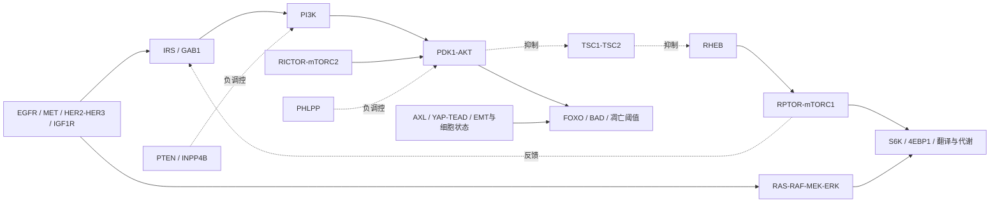

# 奥希替尼＋化疗进展后的 PI3K/AKT/mTOR：研究代码与节点证据地图

本轮记录日期：2026-10-30（上海时区）。目标文献窗口：2016-10-30 至 2026-10-30。

交付内容是可运行、可审查的**研究性候选机制规则工具**及 8 项节点研究笔记。它没有经过患者队列的诊断准确性、治疗预测性或前瞻性临床验证。不能据此开具处方、选择联合剂量或替代病理/分子肿瘤委员会判断。

**文献核验尚受阻。** 本轮真实访问 PubMed、Europe PMC 等网站时被代理策略拒绝（403），不是“未发现文献”。[检索日志](search-run-2026-10-30.json)记录 `blocked`，首组失败后其他组为 `not_run_after_access_failure`，命中数保留 `null`；没有将未执行或访问失败写成零命中。8 项笔记及知识库中的来源均未在线核验，未完成 ASCO、ESMO、AACR、IASLC WCLC 摘要的逐年检索。2025–2026 更新尤其不能宣称已覆盖。

## 核心临床问题

PI3K/AKT/mTOR 的激活可以是候选耐药环节，但现有离线资料不能证明它在**奥希替尼＋铂/培美后**的总体发生率、主导性或各节点的匹配疗效。不能把检出 PIK3CA、PTEN、pAKT 或 pS6 当作该患者已证实的因果机制。

必须分开三个层面：某事件是否具有功能意义、是否参与当前耐药、按此事件选药是否改善该治疗背景中的结局。原始论文的机制实验、治疗试验和地区现行药品标签分别核验。

FLAURA2 的一线起始组合策略研究不能代替组合后逐节点的耐药分析。INSIGHT 2、TATTON、MARIPOSA-2 等研究的既往治疗情境也不能自动视为同一组合失败。HERTHENA-Lung01 等含既往 EGFR-TKI 和铂类暴露，不代表每例都经历同一同步方案进展。当前报告对同步联合失败统一保留 `not_directly_established_for_concurrent_combination_failure`。

## 8 个子任务的实际分工

按并发容量分批完成 8 个独立子任务；第 8 项还复审了代码。多智能体意见不计作独立临床证据。

| 子任务 | 主要节点/问题 | 研究笔记 |
|---|---|---|
| 1 | EGFR/HER2/HER3、MET、IGF1R/INSR、IRS/GAB1 | [上游受体与适配蛋白](01-upstream.md) |
| 2 | PIK3CA/B/R1、PDPK1、AKT1/2/3 | [PI3K–AKT](02-pi3k-akt.md) |
| 3 | PTEN、INPP4B、PHLPP、TSC、STK11–AMPK | [负调控](03-negative-regulators.md) |
| 4 | mTORC1/2、RICTOR/RPTOR/RHEB、S6/4EBP1、反馈与自噬 | [mTOR与输出](04-mtor-feedback.md) |
| 5 | RAS/MAPK、SHP2/SOS1、融合、AXL/YAP/EMT | [交叉与可塑性](05-crosstalk-plasticity.md) |
| 6 | 联合同期/序贯暴露、进展与活检、ADC/临床试验适用性 | [直接临床证据边界](06-combination-clinical.md) |
| 7 | BCL2家族、BIM、KEAP1/NRF2、GPX4、TYMS/DHFR、TP53/RB1 | [凋亡、代谢与化疗](07-chemo-metabolism.md) |
| 8 | 十年检索、国际会议、重复队列、证据适用性、代码误判 | [独立方法审计](08-evidence-audit.md) |

## 节点关系



这是解释检测层次的简图，不代表各事件同样常见、同一克隆共存或均有成熟治疗。

## 运行

在仓库根目录使用 Python 3.10+，无需下载依赖。示例全部为合成记录，不含患者数据。

```bash
python3 -m resistance assess examples/combination_progression.json
python3 -m resistance assess examples/combination_progression.json --format markdown --out report.md
python3 -m resistance assess examples/csv_context.json --findings-csv examples/findings.csv
python3 -m resistance assess examples/plasma_negative.json
python3 -m resistance catalog --out knowledge-export.json
```

输出文件已存在时命令失败并保留原文件；明确指定 `--force` 才覆盖。JSON/CSV 结构错误返回退出码 2。`assess` 成功返回 0 只表示生成了有效研究报告，**不表示诊断成立、治疗有效或文献已核验**。报告包含所有命中读数，不强制选一个主导机制、不汇总为虚构分数；多读数命中不能解释为多个独立克隆。

可选安装：

```bash
python3 -m pip install --no-build-isolation --no-deps .
lung-resistance assess examples/combination_progression.json
```

安装需要已有 setuptools≥68；可直接使用 `python3 -m resistance` 跳过安装。包内包含规则 JSON，无需运行时联网。分析命令不会发送输入数据；`search` 只发送固定文献关键词，不接受病例输入。

## 输入约定

完整输入见[JSON示例](../../examples/combination_progression.json)。它不是原始 FASTQ、BAM、VCF 或自动生成的临床报告解析器，不能代替变异检测、拷贝数分析、病理复核或生物信息学注释。

顶层只允许 `schema_version`（字符串 `1.0`）、`context`、`samples`、`findings`。未知字段、重复 JSON 键、NaN/Infinity、重复样本/发现ID、悬空样本引用、字符串布尔值会报错。不得在示例、测试、Git 提交或检索日志中加入真实患者身份信息。

### 临床背景 `context`

| 字段 | 值和解释 |
|---|---|
| `egfr_mutant_nsclc` | 必填布尔；由已确认的临床诊断提供，工具不建立该诊断 |
| `progression_confirmed` | 必填布尔；未确认进展时不生成耐药候选 |
| `treatment_setting` | `concurrent_osimertinib_platinum_pemetrexed` / `sequential_osimertinib_then_platinum` / `osimertinib_monotherapy` / `unknown`；不由药物列表推断时间顺序 |
| `treatment_phase` | 可选 `induction` / `maintenance` / `post_treatment` / `unknown`；维持期进展仍需记录原诱导方案 |
| `histology` | `adenocarcinoma` / `small_cell` / `squamous` / `other` / `unknown`，由病理提供 |
| `transformation_confirmed` | 必填布尔；只有病理与原疾病关系支持时为真，TP53/RB1不能单独确认 |
| `progression_pattern` | `systemic` / `oligoprogression` / `cns_only` / `unknown`；后两者提示先评估解剖学与局部处理 |

### 样本 `samples`

每项必填 `id`、`material`（`tissue`/`plasma`）、`timepoint`（`baseline`/`progression`）、`quality`（`adequate`/`limited`/`unknown`）。至少提供一个样本，仅有基线不生成进展候选。

`tumor_fraction` 可选，必须为 0–1 的有限数；它是样本肿瘤含量估计，不是变异 VAF。工具不制定通用 ctDNA 阈值。质量受限时降为需要确认；零肿瘤含量时不生成分子候选；阴性结果不能排除组织/蛋白/转化机制。

`pathway_inhibitor_exposure` 可选 `yes`/`no`/`unknown`，指取样时 PI3K/AKT/mTOR 抑制剂暴露；缺失按未知。暴露或未知时保留 pAKT/pERK 反馈或药效解释。研究者仍须人工核对具体药物、时间、前处理和总蛋白。

### 检测发现 `findings`

| 字段 | 约定 |
|---|---|
| `id`, `sample_id` | 发现唯一ID及已声明样本ID |
| `gene` | 大写基因符号；泛AKT蛋白抗体可用 `AKT`，不能把泛抗体当同工型特异结果 |
| `alteration` | `activating_mutation` / `resistance_mutation` / `amplification` / `fusion` / `loss_of_function` / `biallelic_loss` / `single_copy_loss` / `protein_loss` / `phosphorylation` / `overexpression` / `no_alteration_detected` |
| `assay` | `DNA_NGS` / `RNA_NGS` / `FISH` / `IHC` / `PHOSPHO_IHC` / `PROTEOMICS` / `RNA_EXPRESSION`；工具会拒绝FISH点突变、RNA表达推扩增等方法不匹配 |
| `significance` | `pathogenic` / `likely_pathogenic` / `vus` / `unknown`；此处指经人工审查的肿瘤事件意义，不是工具进行的ACMG胚系分级，也不能仅用VEP后果代替功能证据 |
| `variant` | 激活、耐药和失活变异必填具体蛋白/变异身份；热点匹配仅接受简写如 `H1047R` 或 `p.H1047R`，不猜测转录本或自动把三字母HGVS转换为一字母 |
| `phosphosite` | 磷酸化必填；pAKT1 `S473/T308`、AKT2 `S474/T309`、AKT3 `S472/T305` 分别处理，组合位点写法参见知识库，不能把表达当磷酸化 |
| `functional_confirmation` | 可选布尔；由研究者审阅具体事件的功能/结构证据后提供，工具不会独立验证此标记或从基因名推导功能 |
| `orthogonal_confirmation` | 可选布尔；正交确认，不等同于已经证明因果或预测疗效 |
| `internal_positive_control` | 蛋白缺失判读所需；没有有效内部阳性对照的 `protein_loss` 不生成候选 |
| `fusion_in_frame`, `kinase_domain_retained` | 可选布尔；融合的同框与激酶域结构人工复核标记；DNA融合始终需进一步结构/表达确认，RNA融合亦不能仅凭“RNA检出”自动认定功能 |
| `baseline_status` | 可选 `present` / `absent` / `not_assessed`；同事件基线阳性优先于相矛盾的“absent”注释 |
| `baseline_sample_id`, `baseline_comparable` | 新检出解释须有真实基线样本、相同材料、足够质量及人工确认平台覆盖可比；仍仅称 newly detected candidate，不称已证明获得性耐药 |

拷贝数阈值由经过验证的实验室与具体试验定义，不在工具中任设统一倍数。`biallelic_loss` 是需要已核实的输入分类，工具不能从单个LoF或任意LOH标记计算出来。磷酸化纵向比较包含具体位点；首次观察到信号变化不是新获得性基因事件。相同基因的不同失活变异不会被自动合并为同一持续事件。

CSV用于已人工注释的 `findings`，字段与JSON相同，空白可选项视为未提供；布尔值仅接受小写 `true`/`false`。JSON必须显式包含 `findings: []`，避免CSV悄悄覆盖现有发现。见[CSV背景](../../examples/csv_context.json)和[CSV发现](../../examples/findings.csv)。

## 输出和证据审计

核心文件：[引擎](../../resistance/engine.py)、[命令行](../../resistance/cli.py)、[知识库](../../resistance/data/knowledge.json)。

报告保留：规则ID、原始发现ID、样本/方法/变异/位点、支持层级、时间解释、需要确认的检测、候选研究干预、局限、每条来源和人群适用性。所有候选的 `causality` 为 `not_established`，`treatment_recommendation` 为 `null`，`automatic_treatment_match` 为 `false`。

支持层级是内部解释标签，不是 GRADE、ESCAT 或指南推荐等级：

| 示例层级 | 可以说明什么 |
|---|---|
| `molecular_candidate` | 输入满足规则所需注释，仍不是因果诊断 |
| `requires_confirmation` / `requires_fusion_structure_confirmation` | 检测、样本或融合结构证据仍待确认 |
| `functional_clue` / `cell_state_clue` | 有功能/状态线索，不能推断已验证药敏 |
| `pathway_activity_only` | 输出活动读数；pAKT/pS6不定位上游 |
| `phospho_observation_direction_unknown` | IGF/IRS/GAB1位点方向未定，IRS某些丝氨酸可能抑制/反馈；不推导治疗 |
| `requires_allelic_confirmation` / `insufficient_for_functional_loss` | 单一TSC事件/PTEN单拷贝不足以说明双等位或功能依赖 |
| `unvalidated_chemo_association` | TYMS/ERCC1等表达不构成已验证选药依据 |

知识库有 29 条来源线索，其中有原始研究、**1条明确窗口外的2015年RICTOR背景文献**和2条尚待正式题录核验的试验登记定位；不能称为29篇已核验的近十年论文。同一NCI-MATCH登记的不同子方案按子方案分开，不把它们当同一治疗人群。每条来源都有 `verification_status`、`population`、`period_status` 和一般用途；每条规则另列 `source_roles`，报告为 `rule_support_role`，明确该引用在本规则中是节点证据、间接治疗、反例、背景还是登记线索。

例如：

- PIK3CA热点仅列候选；SOLAR-1乳腺癌随机试验不能升级为EGFR联合耐药后的随机治疗证据。
- PTEN缺失不自动匹配PI3Kα抑制剂；TSC单一事件不命中双等位规则。
- MET扩增有其他耐药情境的人体组合研究，仍须逐队列核对既往化疗和地区标签。
- HER3 ADC的活性不是HER3→PI3K信号驱动的证明；PIK3R1/IRS/INPP4B等部分规则只保留明确标注的研究假说和证据缺口。
- 没有证据支持工具预设“所有患者都应继续原EGFR药加通路抑制剂”，也不会按基因名自动组合多药或重新使用已失败化疗。

## 继续近十年论文与会议核验

```bash
python3 -m resistance queries --out search-plan.json
python3 -m resistance search --node all --max-pages 10 --out literature-run.json
```

检索程序使用Europe PMC固定HTTPS API，继承现有代理与CA，保留TLS校验。退出码3表示访问受阻、响应无效或分页受限；日志区分真实零命中、未执行、截断和失败。`metadata_retrieved`也只说明题录/摘要已取得，不能把知识库标为全文/疗效已核验；程序不会自动改写知识库。检索不限定“高影响期刊”，避免漏掉阴性研究，随后人工对重要期刊与会议分层审查。

网络放行草稿需在环境设置中应用并发布后重新验证。除此前文献域名外，会议/出版商全文可能需要实际访问时新增域名；只允许访问并不保证订阅全文可用。逐年会议档案、摘要号、数据截止、后续全文、重复队列和当前监管标签应按[第8项方法记录](08-evidence-audit.md)核对，不用检索页或试验登记冒充已核验原始论文。

更新知识库时逐规则记录来源支持的具体断言、原文/补充材料位置、分母、前后样本、是否同一并发组合失败人群、阴性结果与地区标签。只有人工全文审查可以改变核验状态；完成之后再讨论临床队列外部验证。当前代码测试验证规则行为，不能验证医学真实性、临床敏感度/特异度或患者获益。

## 开发验证

```bash
python3 -m unittest discover -s tests -v
python3 scripts/check_repository.py
```

回归覆盖热点/VUS、同工型、IRS方向、单/双等位、DNA/RNA融合、样本质量、基线/进展、病理转化、CNS与血浆阴性、证据适用性、严格输入、CSV、CLI、分页/失败日志。CI配置见[工作流](../../.github/workflows/test.yml)；本地通过不等于GitHub远端CI已运行。
