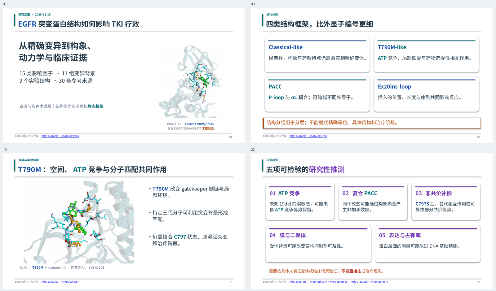

# EGFR蛋白结构与TKI疗效：离线报告与白底PPT

## 30页白底PPT（2026-11-15）

- [直接下载可编辑PPTX（约6.0 MB）](https://github.com/ZhongmianZhang/lungcancer/raw/refs/heads/main/site/egfr-structure/EGFR_structure_white_20261115.pptx)
- [下载PDF预览（约2.9 MB）](https://github.com/ZhongmianZhang/lungcancer/raw/refs/heads/main/site/egfr-structure/EGFR_structure_white_20261115.pdf)
- [幻灯片来源清单](presentation_manifest.json) · [文件与排版检查记录](presentation_verification.json) · [PPT/PDF校验值](PPT_SHA256SUMS.txt)

16:9全白背景，正文可编辑；变异/基因为蓝色，结构/动力学为青绿，证据/推测为紫色，重要边界为橙红。包含8个实验结构的内嵌静态图片、9个结构清单、30条来源及逐页备注。图片与正文可离线查看；外部参考链接和配套HTML下载需要联网。PPT中的图片为静态投影；可旋转模型在配套离线HTML中。

使用 Noto Sans CJK SC 字体；系统缺少该字体时，PowerPoint/WPS可能采用本地中文字体替换。PDF可用于查看固定排版。

## 单文件离线HTML

**推荐先下载ZIP，解压后在本机Chrome或Edge中打开里面唯一的HTML。**

- [直接下载ZIP：解压后只有一个HTML](https://github.com/ZhongmianZhang/lungcancer/raw/refs/heads/main/site/egfr-structure/EGFR_structure_offline_20261115.zip)
- [直接取得HTML文件](https://github.com/ZhongmianZhang/lungcancer/raw/refs/heads/main/site/egfr-structure/EGFR_structure_offline_20261115.html)
- [离线检查记录](offline_verification.json)
- [文件校验值](SHA256SUMS.txt)
- [构建代码与原始输入](../../egfr_structure/)

GitHub和ChatGPT的文件预览可能显示HTML源码。保存到电脑后，使用浏览器打开 .html 文件；不要将网页源码另存为 .txt。

HTML内置完整正文、30条参考来源和9个实验3D结构，可离线切换结构、旋转、缩放、观察结合口袋、保存PNG，以及导出原始PDB和CSV/JSON。它不依赖同目录其他文件或CDN；只有访问外部论文/平台链接需要网络。

日期：2026-11-15。研究范围、构建体工程改造和变异编号说明均保留；未计算患者个体药敏或自动处方。

