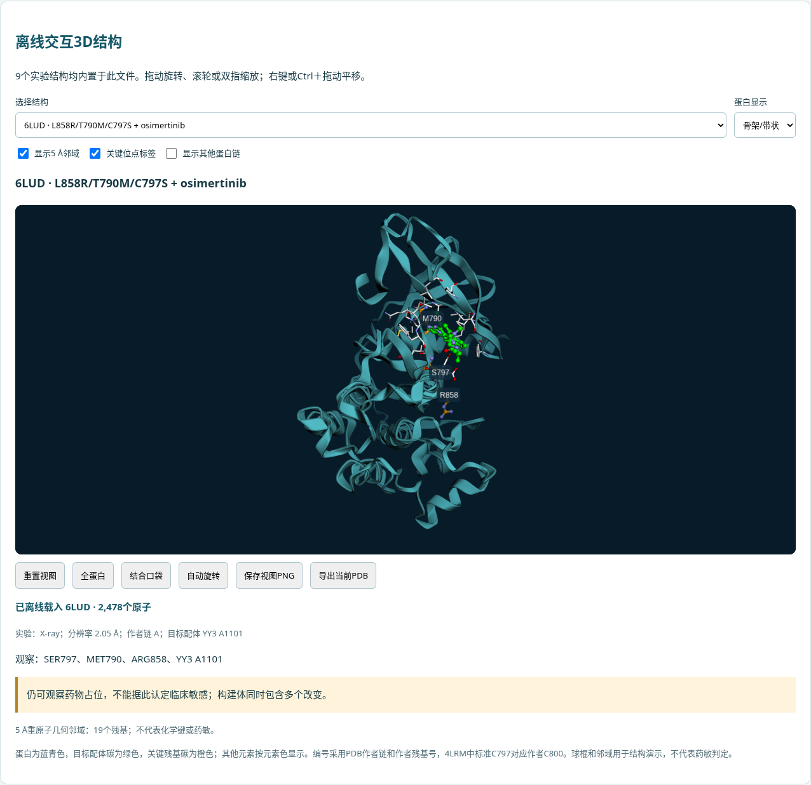

# EGFR蛋白结构与TKI疗效：单文件离线报告

**推荐先下载ZIP，解压后在本机Chrome或Edge中打开里面唯一的HTML。**

- [直接下载ZIP：解压后只有一个HTML](https://github.com/ZhongmianZhang/lungcancer/raw/refs/heads/main/site/egfr-structure/EGFR_structure_offline_20261115.zip)
- [直接取得HTML文件](https://github.com/ZhongmianZhang/lungcancer/raw/refs/heads/main/site/egfr-structure/EGFR_structure_offline_20261115.html)
- [离线检查记录](offline_verification.json)
- [文件校验值](SHA256SUMS.txt)
- [构建代码与原始输入](../../egfr_structure/)

GitHub和ChatGPT的文件预览可能显示HTML源码。保存到电脑后，使用浏览器打开 .html 文件；不要将网页源码另存为 .txt。

HTML内置完整正文、30条参考来源和9个实验3D结构，可离线切换结构、旋转、缩放、观察结合口袋、保存PNG，以及导出原始PDB和CSV/JSON。它不依赖同目录其他文件或CDN；只有访问外部论文/平台链接需要网络。

日期：2026-11-15。研究范围、构建体工程改造和变异编号说明均保留；未计算患者个体药敏或自动处方。

